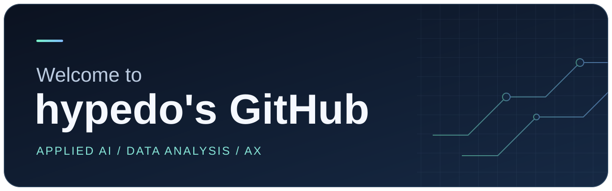

**AI로 실제 업무의 어떤 부분을 개선할 수 있을지 실험합니다.**

AI 전환(AX)에 관심을 두고, 해결할 문제를 정의한 뒤 데이터와 사전학습 모델로 접근 방법을 검증합니다. 모델 점수와 함께 결과를 어떤 의사결정에 활용할 수 있는지, 실제 적용 전에 무엇을 더 확인해야 하는지 정리합니다.

## 사용하는 도구

| 도구 | 활용 |
| --- | --- |
| **Python** | 데이터 전처리, 탐색 분석, 모델 실행, 결과 시각화 |
| **Hugging Face** | 사전학습 모델과 토크나이저 불러오기, 입력 데이터로 추론 실험 |
| **Google Colab** | 노트북에서 모델과 분석 코드 실행 |
| **Jupyter Notebook** | 실험 과정, 비교표, 시각화를 한곳에 기록 |

## 프로젝트

| 프로젝트 | 다룬 문제 |
| --- | --- |
| **항만 선박 식별** | 한글 음차·약칭과 불완전한 선박 기록을 카탈로그 ID에 연결했습니다. 후보 검색, CatBoost, Qwen 재정렬을 결합한 팀 프로젝트입니다. |
| **BC 장보기 핏** | 소비데이터로 장보기 채널 비중을 예측하고, 예측 오차 개선이 혜택 패키지 선택에 얼마나 도움이 되는지 비교했습니다. |
| **Phasera · 미세조직 상 분할** | 알루미늄 합금 현미경 영상의 네 상을 픽셀 단위로 분할하고, 앙상블과 후처리의 효과를 개발 검증 데이터에서 비교했습니다. |
| **EPL 팬 반응 텍스트 분석** | 댓글과 카페 게시글을 감정과 주제로 나눠 경기 라운드별 반응과 38라운드 전후 변화를 비교했습니다. |

요즘은 기존 모델을 새 데이터에 적용할 때 **어떤 기준선과 비교해야 하는지**, 그리고 **점수 개선이 실제 업무나 사용자에게 어떤 차이를 만드는지**에 관심이 있습니다.
